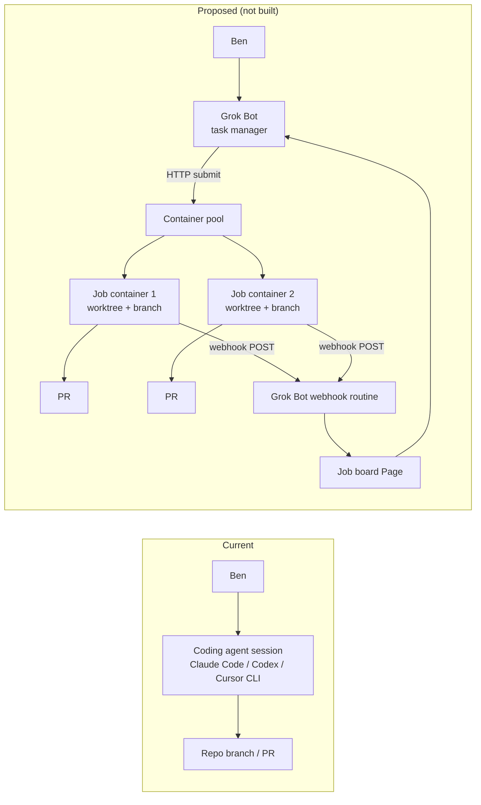
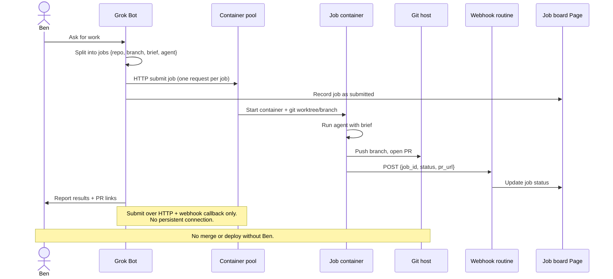
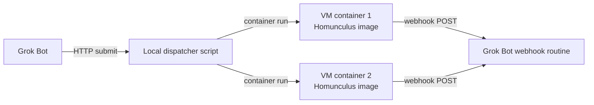
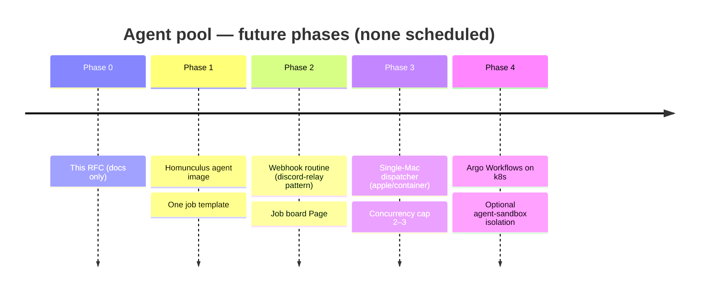

# RFC: Agent pool

`template: rfc · reason: development-workflow document step for cross-cutting architecture`

**Status: Proposed, not scheduled**

> **Future idea only.** This RFC records a workflow idea for later. Nothing here is implemented, and this PR adds no code, infra, CI, or skill changes.

Grok Bot acts as a central task manager. It sends coding-agent jobs (Claude Code / Codex / Cursor CLI) to a container pool and collects the results.

## Problem {#problem}

There is no central way to split one request into coding-agent jobs, run each job in an isolated container, and track the PRs they open. Grok Bot could fill that role, but it cannot hold a persistent connection.

## Current vs proposed {#current-vs-proposed}

Today one person drives one agent session. In the proposal, Grok Bot dispatches jobs over HTTP, and each container calls back through a webhook. Grok Bot never holds a persistent connection.

## Data flow {#data-flow}

The callback uses the same pattern as the discord-relay webhook routine. Containers report timeouts as a status and do not retry forever.

## Decision table {#decision-table}

Pool backends researched in Nov 2026:

| Option | Notes | Choice | Link |
| --- | --- | --- | --- |
| Argo Workflows | Apache-2.0. Its events API can submit WorkflowTemplates over HTTP, which fits the no-persistent-connection rule. Works on OrbStack k8s. | **Top pick for k8s** | https://github.com/argoproj/argo-workflows |
| GitHub Actions Runner Controller + `repository_dispatch` | Close second, but tied to GitHub | Runner-up | https://github.com/actions/actions-runner-controller |
| kubernetes-sigs/agent-sandbox | Isolation layer | Consider later | https://github.com/kubernetes-sigs/agent-sandbox |
| OpenHands | Full control plane; ACP lacks Cursor CLI | No | https://github.com/OpenHands/OpenHands |
| Dagger container-use | Local only | No | https://github.com/dagger/container-use |
| Claude Squad | Local only | No | https://github.com/smtg-ai/claude-squad |
| Sculptor | Local only | No | https://github.com/imbue-ai/sculptor |
| Vibe Kanban | Local only | No | https://github.com/BloopAI/vibe-kanban |
| Coder | | No | https://github.com/coder/coder |
| E2B runtime | Needs KVM; does not run on Apple silicon | No | https://e2b.dev/ |
| Daytona OSS | Archived (GitHub `archived: true`; last push mid-2026) | No | https://github.com/daytonaio/daytona |
| Temporal | Possible, but heavier | No | https://github.com/temporalio/temporal |

**Leaning:** use Argo Workflows on k8s, and use the single-Mac path below on a MacBook Air.

### Single-Mac option {#single-mac}

On a MacBook Air, a small dispatcher script calls `container run` and the containers call back through the webhook. There is no orchestrator.

- Apple's `apple/container` CLI: Apache-2.0, **v1.6.1** (checked against GitHub releases). It runs one lightweight VM per container, uses OCI images, targets Apple silicon, and works best on macOS 26. https://github.com/apple/container
- `apple/containerization` Swift package: https://github.com/apple/containerization
- None of the big orchestration projects support Apple container. Small reference projects:
  - https://github.com/pedrojmfreire/container-agents
  - https://github.com/OlivierAlter/ai-council
  - https://github.com/TakiTake/pall8t
  - https://github.com/yau-ref/agentwrap

## Rollout timeline {#rollout-timeline}

Only Phase 0 exists. Every later phase is unscheduled.

Glue to build later (not built here):

- Homunculus agent image, with logins passed through env vars or mounted secrets and **never baked in**
- One job template
- Webhook routine (discord-relay pattern)
- Job board Page
- Concurrency cap (2–3 on a MacBook Air)
- Short-lived, repo-scoped tokens
- Timeouts reported as a status, not retried forever
- **No merge or deploy without Ben**

## Risks {#risks}

| Risk | Impact | Mitigation |
| --- | --- | --- |
| Secrets leak through an image | High | Pass logins only through env vars or mounted secrets; never bake them into images |
| Over-broad or long-lived git credentials | High | Use short-lived, repo-scoped tokens |
| Agent merges or deploys unreviewed work | High | No merge or deploy without Ben |
| MacBook Air runs out of resources | Medium | Cap concurrency at 2–3 |
| Stuck jobs loop forever | Medium | Report timeouts; do not retry forever |
| Lost callback leaves a job's status unknown | Medium | Job board keeps the submitted state, so unanswered jobs stay visible |
| Grok Bot cannot hold a connection | Constraint | HTTP submit + webhook callback only |
| Apple container has no orchestrator support | Medium | Use a small local dispatcher script; use Argo for k8s |

## Verification {#verification}

How we would know it works, if it is built later:

- [ ] Grok Bot submits a job over HTTP and gets a `job_id` without holding a connection open
- [ ] Each job runs in its own container, git worktree, and branch, and opens a PR
- [ ] The container POSTs `{job_id, status, pr_url}` to the webhook routine
- [ ] The job board Page shows submitted, done, failed, and timed-out jobs
- [ ] A forced timeout shows up as a status and is not retried forever
- [ ] No secrets appear in image layers
- [ ] Tokens are short-lived and scoped to one repo
- [ ] No more than 2–3 jobs run at once on the MacBook Air
- [ ] No PR is merged or deployed without Ben

## Out of scope / non-goals {#out-of-scope}

- Any implementation in this PR (code, infra, CI, images, skills)
- Auto-merge or auto-deploy
- A persistent connection between Grok Bot and the pool
- Baking credentials into images
- Picking a final k8s cluster or hosting setup
- Scheduling any phase
