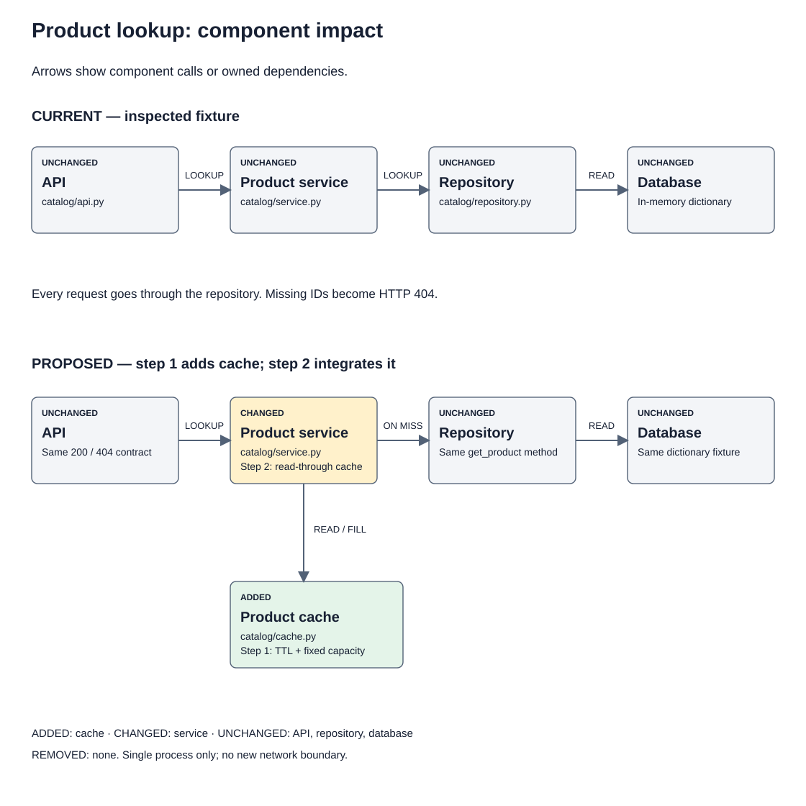
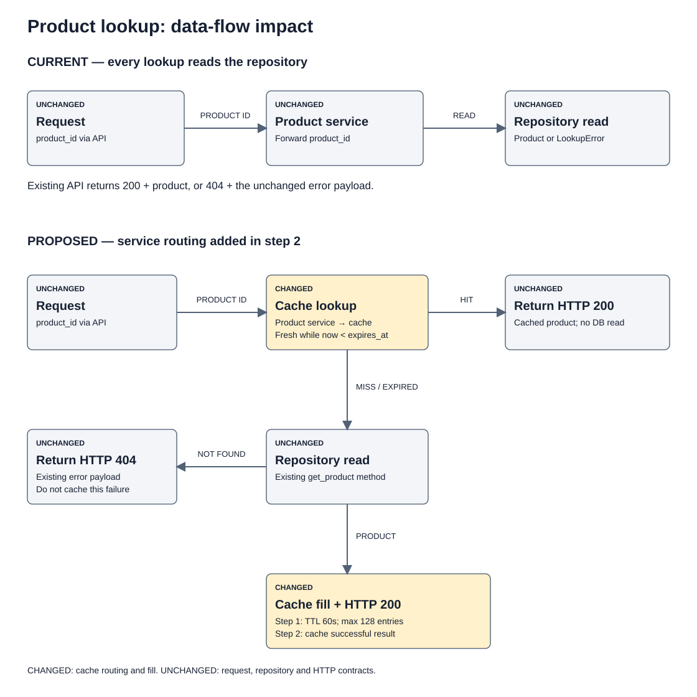

# Mock plan: cache product lookup for 60 seconds

Worked example only. The bundled fixture captures the current state; the two caching commits below are proposed and have not been implemented. Read from `fixture/` when running its baseline checks.

## Context

Mock request: reduce repeated repository reads by caching successful product lookups for 60 seconds. Keep the public response contract and missing-product behavior unchanged.

Current state, inspected in the fixture:
- `fixture/catalog/api.py:1` calls the service and maps `LookupError` to `(404, {"error": "Product not found"})`.
- `fixture/catalog/service.py:1` delegates every lookup to the repository.
- `fixture/catalog/repository.py:1` reads an in-memory dictionary and raises `LookupError` for missing IDs.
- `fixture/tests/test_lookup.py` checks both successful and missing-product response contracts.

Target state: add a local, bounded TTL cache owned by the product service. A fresh hit returns the cached product without reading the repository. A miss or expired entry reads the existing repository, caches a successful result, then returns it. Failed lookups are not cached.

Mock assumptions: one process and one thread; callers treat product dictionaries as read-only. Up to 60 seconds of stale product data is acceptable. Capacity is fixed at 128 entries with oldest-insertion eviction. These are test-scenario decisions, not production requirements.

Branch: undecided; base: the supplied fixture. The fixture is not a Git checkout.
Regression guard: the existing 200 response payload, 404 response payload, and LookupError mapping must continue to pass without changes to the API or repository.

## Visualized impact (architecture and data flow)

Step 1 adds `catalog/cache.py`; step 2 changes `ProductService` to own and call it. The API, repository, and dictionary database retain their responsibilities. Architecture arrows represent component calls or owned dependencies, not chronological commit order.

Step 2 adds the fresh-hit and miss/expired paths. Only successful repository results reach the cache fill. A missing product follows the existing 404 path. The diagram shows product IDs flowing into lookups and products flowing into successful responses; arrows are labeled with the relevant outcomes.

## Steps (one commit each, Conventional Commits)

1. **feat(catalog): add a bounded product TTL cache**
   - Add `fixture/catalog/cache.py` and `fixture/tests/test_cache.py`. Keep existing callers untouched so the initial commit preserves current behavior.
   - Use standard-library `OrderedDict` for oldest-insertion eviction and `time.monotonic()` for expiry. Expire entries when `now >= expires_at`; avoid wall-clock timestamps and background cleanup jobs.
   - Expose `get(product_id)` and `put(product_id, product)`. A missing or expired entry returns `None`; the fixture stores product dictionaries, so this cannot collide with a valid value.
   - Remove expired entries on lookup; evict the oldest insertion when adding a new key would exceed 128 entries. Replacing a key refreshes its TTL and insertion position.
   - Test fresh hits, exact-boundary expiry, key isolation, expiry removal, replacement, and bounded eviction with a patched clock. No sleeps or new dependencies.

2. **feat(catalog): cache successful product lookups**
   - Update only `fixture/catalog/service.py` and add `fixture/tests/test_cached_lookup.py`.
   - Preserve `ProductService(repository)` compatibility by constructing the cache internally. Return a fresh cache hit; otherwise reuse `ProductRepository.get_product`, then cache its successful result.
   - Let `LookupError` propagate to the existing API handler. Preserve error messages and status codes; do not cache failures.
   - Use a counting fake repository to prove a fresh repeated lookup performs one repository read, expiry causes another read, distinct IDs stay separate, and repeated missing IDs continue through the repository.
   - Re-run the existing response-contract tests unchanged. No API, repository, database, or dependency changes belong in this commit.

Out of scope: distributed caching, write invalidation, background refresh, concurrent access, persistence, changes to product contracts, and deployment.

## Verification

Run from `fixture/` after each intended commit:
- `python -m compileall -q catalog tests`
- `python -m unittest discover -s tests -v`

There is no configured lint, typecheck, or build tool in this fixture; do not invent a project gate. Include each new behavior test with the commit that introduces it so every intermediate tree can pass.

Final checks: fresh hits skip repository reads; exact-boundary expiry reloads; missing IDs remain 404 and are never cached; capacity stays at 128; existing payload contracts remain unchanged. These are planned acceptance checks, not claims that caching is already implemented.

Diagram checks: resolve both relative image links; parse SVG XML; verify accessible titles, descriptions, arrowheads, and viewBox; render both SVGs and inspect labels, connections, and legend. Compare the current panels with the inspected fixture and mark all future behavior as proposed.

Follow-up: review this mock plan before implementation. No forge or deployment action is needed for the fixture.
