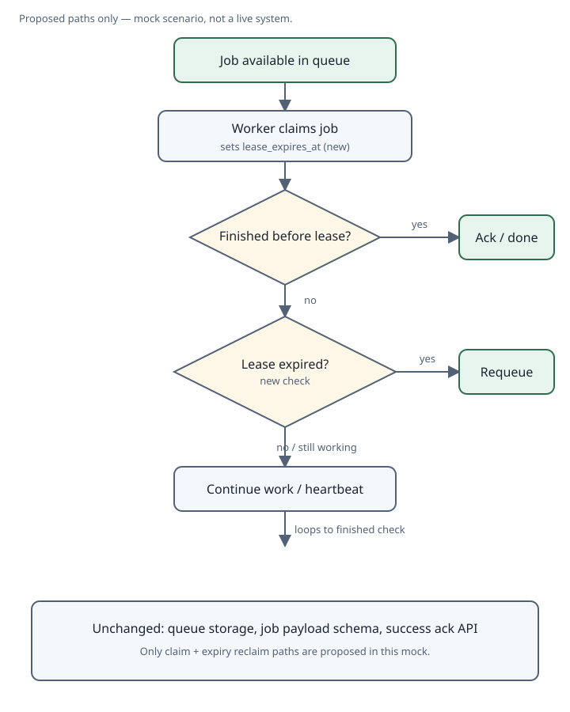

# Mock plan: reclaim jobs when a worker lease expires
<!-- template: change-plan -->

Worked example only. Scenario choices here are not requirements for other plans.

## Decision needed

**Proposal:** When a worker claims a job, attach a short lease. If the lease expires before the job is acknowledged, return the job to the queue so another worker can claim it. Successful acks and the public job payload stay the same.

## How it works / flow

A claim writes `lease_expires_at`. Finishing before expiry acknowledges as today. Expiry without an ack requeues the job. Heartbeats may extend the lease while work continues; that detail is optional in this mock.

## Before vs after

| Situation | Today | After change |
| --- | --- | --- |
| Worker finishes and acks on time | Job completes | Job completes (unchanged) |
| Worker dies after claim | Job stays claimed indefinitely | Lease expires; job becomes claimable again |
| Slow worker still making progress | N/A (no lease) | Heartbeat extends lease; no reclaim |
| Duplicate ack after success | Ignored or idempotent success | Same behavior |
| Invalid job payload | Rejected at enqueue / claim | Unchanged |

## Implementation

1. **Add lease fields on claim** — Persist `lease_owner` and `lease_expires_at` when a worker claims a job. Default TTL is a mock constant (e.g. 5 minutes), overridable later.
2. **Reclaim on expiry** — A periodic scan (or claim-time check) returns expired, unacked jobs to the ready state and clears the lease owner.
3. **Optional heartbeat** — Allow the owner to extend `lease_expires_at` while status remains in-progress.
4. **Tests and docs** — Cover happy ack, expiry reclaim, heartbeat extension, and idempotent ack. Document the TTL default.
5. **Open a PR** — One Conventional Commit series; no production deploy until review.

## Unchanged

- Queue storage backend and partitioning
- Job payload schema and enqueue validation
- Success acknowledgment API shape
- Metrics names already emitted for enqueue/ack (add lease metrics separately if needed)

## Status

- [x] Mock plan written
- [ ] Approver accepts the proposal
- [ ] PR opened
- [ ] Reviewed
- [ ] Deployed

Out of fixture scope: multi-region fencing, exactly-once side effects, and changing the job payload contract.
