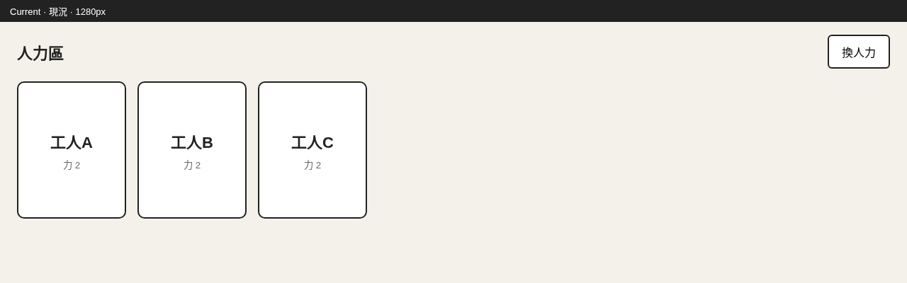
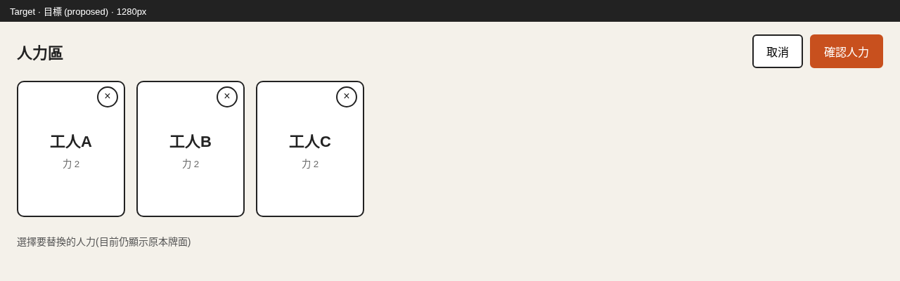
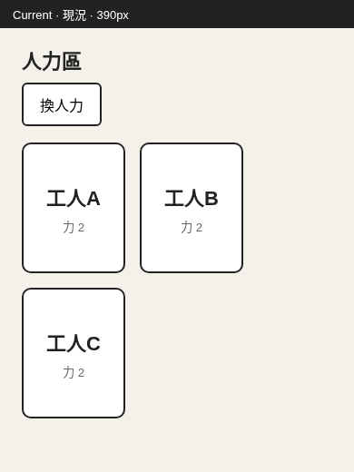
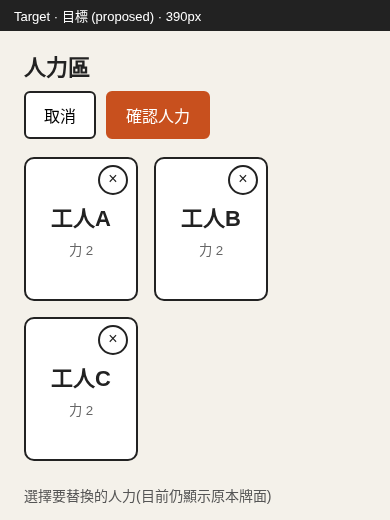
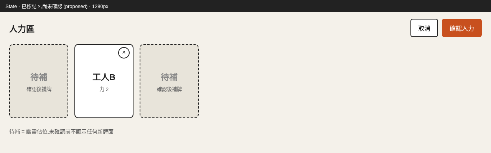
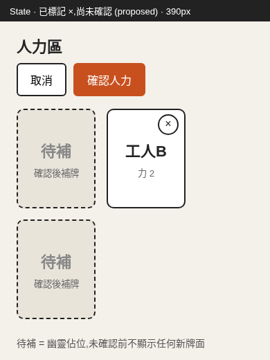

# Mock plan: confirm before refilling job cards (換人力)
<!-- template: implementation-plan -->

Worked example only. Product, copy, and file names are illustrative, not requirements for other plans.

## Decision needed

**Proposal:** Add a confirm step to 換人力. Tapping 換人力 enters a selection mode; new job cards are dealt only after 確認人力. 取消 restores the current hand.

## Wireframes

Worked example only: this repo has no app to build, so both current and target frames are HTML/CSS mockups rendered with headless Playwright at 1280 and 390 px. In a real plan, current frames come from a local production build.

**Desktop · current (1280)**

**Desktop · target (1280)** — 取消 / 確認人力 and × marks are **proposed**

**Mobile · current (390)**

**Mobile · target (390)**

**State · after marking ×, before 確認人力** — marked cards become 待補 ghosts; no new faces

| file | sha256 |
| --- | --- |
| img/desktop-1280-current.png | 521cbc69cae07732e57a5c8e9a07d72360a7f7dc76dd8cd730d0ec4a5edc9a84 |
| img/desktop-1280-marked.png | 662a800a41ed85211835615363787f83c7f3117215ef0ef4af2e938a349e822d |
| img/desktop-1280-target.png | ff0dfc7d7dd95e0559c479dbef7abae4cb88e06c488abd9cb1e9376b1cf1bae1 |
| img/mobile-390-current.png | 3c2bc0a1997dd7c83001611a51879a51f2b7bae22da2bccbce9358de60cd76cf |
| img/mobile-390-marked.png | 2332bd35db2a7a1a2572fd62803ebd689cce8037f29c510fd48381b63e59f280 |
| img/mobile-390-target.png | bad60f7d8f36ef510c3ec12b130a8737f85751d561fe8c659b3954483a2d522e |

| Label | Component / file | Change |
| --- | --- | --- |
| `換人力` | `src/ui/HandHeader.tsx` | Enters selection mode instead of refilling |
| `×` | `src/ui/JobCard.tsx` | Marks card for replacement; does not flip or deal |
| `待補` (proposed) | `src/ui/JobCard.tsx` | Ghost placeholder for a marked card |
| `確認人力` (proposed) | `src/ui/HandHeader.tsx` | Only action that deals new cards |
| `取消` (proposed) | `src/ui/HandHeader.tsx` | Clears marks, restores hand |

Hidden information: until 確認人力, ×, swap, and 取消 show backs, ghosts, or still-current faces only. No new face appears in any frame or transition before confirm. New cards are revealed only after 確認人力.

## Implementation

1. Add selection state to `HandHeader.tsx`.
2. Mark/unmark on `JobCard.tsx`.
3. Deal on confirm only; animate after confirm.

## Unchanged

Deck order, deal rules, and the hand size limit.

## Status

- [x] Plan
- [ ] Approval
- [ ] PR
